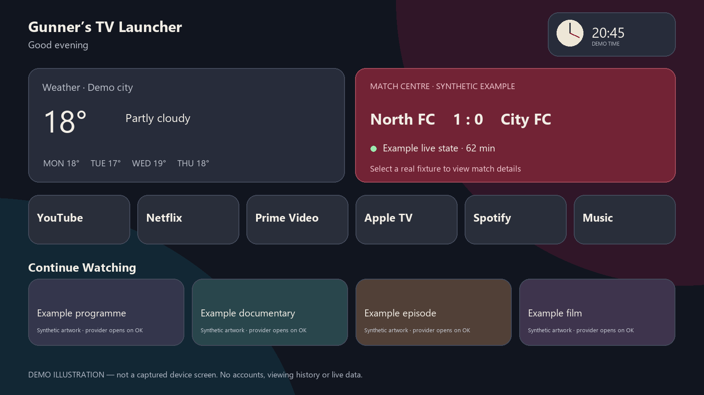

# Gunner's TV Launcher

A football-focused home screen for Android TV and Google TV: your apps, fixtures, weather and music in one place.

Version: **1.3.0 / 5**. Android package: `dev.gunnerstv.launcher`. Minimum Android API: **26 (Android 8.0)**.

## Features

- Six favourite apps, installed-app discovery and remote-friendly navigation.
- Hold OK on an app → Move app: use the direction buttons to rearrange, OK to save, or Back to cancel. Home supports left/right across its six apps; the Apps tab also supports up/down across rows.
- Clock, time-of-day greeting, configurable weather and animated forecast.
- Utility widgets above the apps; recommendations and football fixtures below.
- Separate recommendations and Continue Watching rows for supported providers when they share content with Android TV. Individual rows can be turned off.
- Now Playing and shortcuts for Wi-Fi, audio output, Google Home and system settings, where the device supports them.
- First-run and Settings football setup: choose a main club or none, search for your own clubs/players, and select club/international/both player fixtures. No personal list is preselected; provider coverage applies.
- All-competition fixtures for chosen clubs, live-match priority, chosen-main-club fallback, and a match centre with overview, head-to-head results, lineups and provider commentary. Times use the TV's local time zone.
- Football centre → News: recent public YouTube fan-channel videos for followed clubs, with club filters and editable creators. No YouTube account or paid API is needed. See [News sources](docs/NEWS-SOURCES.md).
- Saved navigation position and Home-to-top behaviour.

## Install

Follow [DEVICE-SETUP.md](DEVICE-SETUP.md), or copy the complete [installation prompt](https://github.com/vitalisdexter/gunners-tv-launcher/blob/main/INSTALL-PROMPT.md) into an AI assistant with local terminal access. The prompt starts from this public GitHub repository, detects Windows/macOS/Linux, collects your device and football preferences, builds a signed evaluation APK and guides installation, setup, recovery and checks.

Supported targets are Android TV/Google TV devices running Android 8.0 or newer. Other Android boxes need their TV capabilities checked individually. This APK does not install directly on Samsung Tizen, LG webOS, Roku or Apple TV; those televisions can use a compatible external Android TV box. Fire TV and manufacturer-specific Home restrictions need separate compatibility checks.

Clone [vitalisdexter/gunners-tv-launcher](https://github.com/vitalisdexter/gunners-tv-launcher) and build a debug APK locally. Public cloning requires no GitHub login. No signed production APK release is currently published; check the actual [Releases page](https://github.com/vitalisdexter/gunners-tv-launcher/releases) before assuming one exists. The local release build is unsigned and requires separate signing before installation.

## Build independently

Install Java 17 and Android SDK platform 34/build-tools 34.0.0. Set `JAVA_HOME` and `ANDROID_HOME`. The checked-in Gradle 8.9 wrapper uses AGP 8.5.2. No sibling checkout, personal SDK path or signing key is required. First build downloads public dependencies; offline builds require a previously populated ordinary Gradle cache.

Windows: `./Build.ps1`. Linux/macOS:

```sh
chmod +x gradlew
./gradlew --no-daemon --max-workers=2 testReleaseUnitTest lintRelease assembleRelease assembleDebug
```

Debug QA APK: `app/build/outputs/apk/debug/app-debug.apk`, signed with the local Android debug identity. This is not a production signing key. Release APK: `app/build/outputs/apk/release/app-release-unsigned.apk`. It cannot be installed until signed separately. No signing credentials are included. See [RELEASE.md](RELEASE.md).

## Configuration and safe setup

See [CONFIGURATION.md](CONFIGURATION.md) for name, weather, favourites and following. Builds do not connect to a TV. Device actions require an explicit target and deliberate invocation. Keep the same signing identity for future updates of an installed package.

This application has a new package identity and is a fresh setup, not an in-place upgrade. Existing launcher settings/databases are not migrated or removed.

## Limits

Content comes only from Android TV records that installed apps publish. Netflix/YouTube/Prime/Apple TV may expose recommendations without resumable titles, or nothing. YouTube Continue Watching is supported by the launcher but depends on YouTube publishing suitable records; the launcher cannot retrieve YouTube watch history. Exact resume is controlled by each provider. Music rows do not access Spotify history or promise Premium features. Now Playing needs a provider media session; the launcher cannot force YouTube/other apps to keep playing after Home. See [Now Playing setup](CONFIGURATION.md#now-playing). Football endpoints are undocumented public ESPN endpoints with incomplete/delayed coverage and no service guarantee; setup supports up to 12 clubs/8 players, with no search account/key. Future player participation is tentative until a lineup/appearance is reported. Weather uses Open-Meteo; its service terms apply independently of this code licence.

If Content sources lists titles but Home is missing their rows, use Settings → Content sources → Refresh, then Show shared rows on Home. The report identifies rows hidden by the Home settings and distinguishes access problems from unpublished content. Existing visibility choices are retained until you explicitly enable them. Empty feeds show a setup/status card when supported apps are installed, rather than silently hiding the access route.

No private app databases, account passwords, playlist credentials or analytics are collected. See [PRIVACY.md](PRIVACY.md). Runtime club/provider logos are their owners’ marks, not a claim of endorsement. This project is not affiliated with Arsenal, any league, provider or TV manufacturer.

Local verification and remaining physical checks are recorded in [VALIDATION.md](VALIDATION.md). A successful build is not proof of correct behaviour on every TV. Current hosted build results are available in [GitHub Actions](https://github.com/vitalisdexter/gunners-tv-launcher/actions).

## Licence and contributions

Gunner's is independently branded and includes open-source components. Required attribution and component records are in [THIRD_PARTY_NOTICES.md](THIRD_PARTY_NOTICES.md) and [legal/SOURCE-PROVENANCE.md](legal/SOURCE-PROVENANCE.md). Artwork records are in [ASSETS.md](ASSETS.md). See [CONTRIBUTING.md](CONTRIBUTING.md) for changes and [CHANGELOG.md](CHANGELOG.md) for release notes.

## Support my work

Enjoying Gunner's or my other projects? **[☕ Buy me a coffee](https://buymeacoffee.com/vitalisdexter)** to support my work. Thank you! Support is optional and unlocks no app features. In the launcher, Settings → Buy me a coffee (also available in About) shows the same link and a QR code for your phone.

## Illustrative preview



The diagram communicates the layout family only; labels, weather and scores are synthetic. It is not runtime validation.
